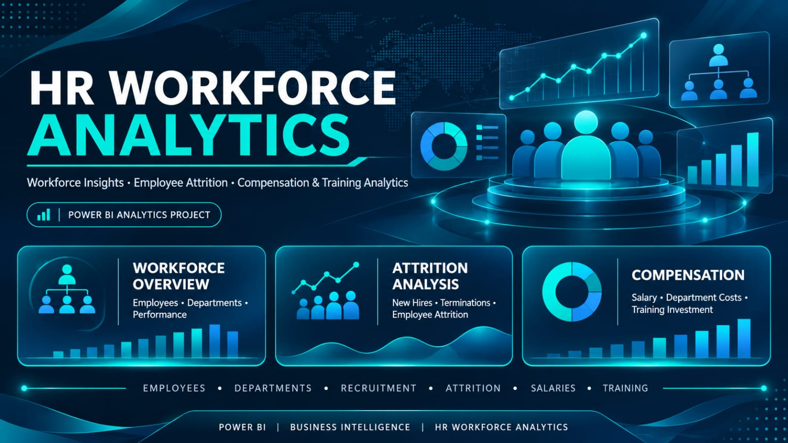
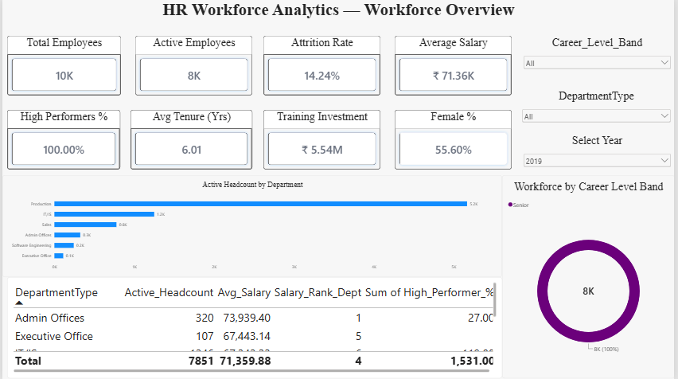
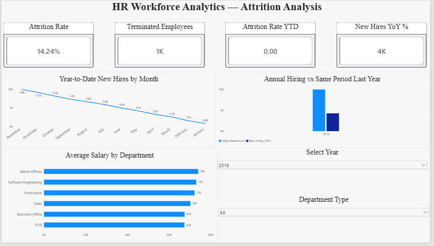
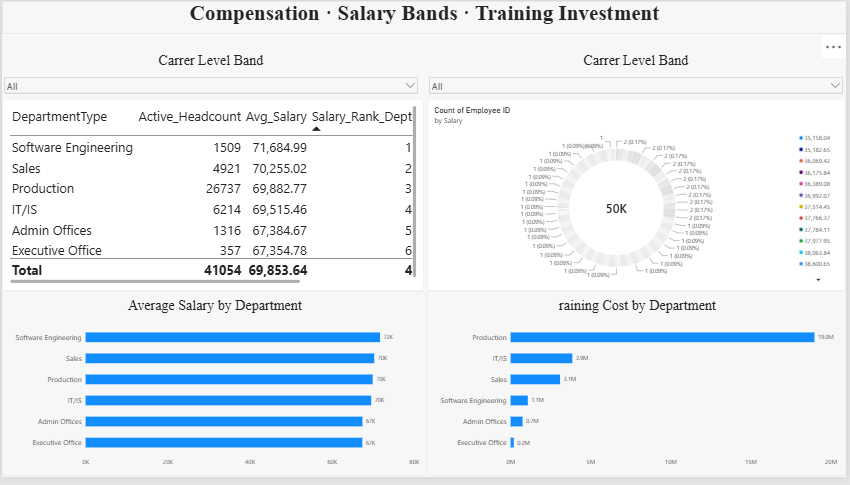

# 👥 HR Workforce Analytics Dashboard

 

*An interactive Power BI dashboard for analyzing employee demographics, workforce distribution, recruitment, employee attrition, compensation, performance, and training.*

---

# 🎥 Project Demo Video

> 📺 Click the button above to watch the complete project demonstration and SQL explanation video.
---

## 📖 Project Overview

The **HR Workforce Analytics Dashboard** is a Power BI data analytics project designed to analyze employee information and workforce performance.

It transforms multiple HR datasets into an interactive report that helps explore workforce distribution, employee hiring and termination trends, department-wise attrition, compensation, employee performance, and training investments.

The project uses five CSV datasets containing employee, training, engagement survey, performance, and recruitment information.

The report contains three analytical pages:

1. **Workforce Overview** — Employee headcount, workforce distribution, department analysis, career levels, and employee performance.
2. **Attrition Analysis** — Employee hiring trends, year-to-date recruitment, previous-year comparisons, and department-wise attrition.
3. **Compensation** — Department-wise salary analysis, training costs, salary rankings, and compensation comparisons.

---

## 🎯 Project Objectives

- Import multiple HR CSV datasets into Power BI.
- Clean and transform employee data using Power Query.
- Prepare and organize HR datasets.
- Build relationships between employee, training, engagement, and performance tables.
- Create a date table for time-based workforce analysis.
- Configure active and inactive date relationships.
- Create DAX measures for workforce KPIs.
- Analyze active employees, new hires, and terminated employees.
- Calculate employee attrition and year-over-year hiring trends.
- Analyze employee distribution by department and career level.
- Evaluate employee performance and training investments.
- Compare salaries across departments.
- Create interactive KPI cards, charts, donuts, and matrices.
- Design a professional multi-page HR analytics dashboard.

---

## 🛠️ Technologies Used

| Tool / Technology | Purpose |
|---|---|
| Microsoft Power BI Desktop | Dashboard creation and data visualization |
| Power Query Editor | Data cleaning and transformation |
| DAX | Measures and analytical calculations |
| CSV Files | HR source datasets |
| Power BI Data Model | Relationships between HR tables |
| GitHub | Project documentation and version control |

---

## 🗃️ Dataset

The project uses five HR CSV datasets containing employee information, training records, engagement survey responses, performance information, and recruitment data.

### Source Tables

| Power BI Table Name | Source Data |
|---|---|
| `EmployeeMaster` | employee_data.csv |
| `Training` | training_and_development_data.csv |
| `EngagementSurvey` | employee_engagement_survey_data.csv |
| `Performance` | performance_data.csv |
| `Recruitment` | recruitment_data.csv |
| `DimDate` | Date table created for time-based analysis |
| `_Measures` | Dedicated table for DAX measures |

Each of the five source CSV datasets contains approximately 50,000 records.

### Important Fields

- `EmployeeID`
- `DateOfJoining`
- `DateOfTermination`
- `EmployeeStatus`
- `DepartmentType`
- `Tenure_Years`
- Employee career level
- Employee performance
- Salary information
- Training cost
- Recruitment information

---

## ⚙️ Data Preparation and Modeling

### Power Query Preparation

The main data preparation steps include:

1. Importing all five HR CSV datasets into Power BI.
2. Renaming queries to consistent table names.
3. Checking column names and data types.
4. Cleaning and preparing employee information.
5. Reviewing missing and null values.
6. Preparing training, engagement, performance, and recruitment datasets.
7. Creating a `DimDate` table for date-based reporting.
8. Creating a dedicated `_Measures` table for DAX calculations.

### Data Model

The report uses a relational data model to connect employee information with supporting HR datasets.

Key relationships include:

- `EmployeeMaster[EmployeeID]` → `Training[EmployeeID]`
- `EmployeeMaster[EmployeeID]` → `EngagementSurvey[EmployeeID]`
- `EmployeeMaster[EmployeeID]` → `Performance[EmployeeID]`
- `DimDate[Date]` → `EmployeeMaster[DateOfJoining]` (Active)
- `DimDate[Date]` → `EmployeeMaster[DateOfTermination]` (Inactive)

The `Recruitment` table is kept disconnected as specified in the project model.

### Date Analysis

The `DimDate` table supports time-based workforce analysis.

Important date fields include:

- Date
- Year
- Quarter
- Month Number
- Month Name
- Year-Month

The date table supports hiring analysis, year-to-date calculations, and previous-year comparisons.

### DAX Calculations

DAX is used to create analytical measures for workforce reporting.

Important measures include:

- `Active_Headcount`
- `Senior_Headcount`
- `Terminated_Count`
- `YTD_New_Hires`
- `New_Hires_YoY`
- `Attrition_Rate_YTD`
- `Total_Training_Cost`
- `Training_Cost_Rank`

These measures support employee headcount, hiring, termination, attrition, seniority, and training-cost analysis.

---

## 📊 Dashboard Pages and Features

### 👥 Page 1 — Workforce Overview

This page provides an overview of the organization's workforce and employee distribution.

**KPI Cards**

- Workforce headcount and employee status indicators.
- Employee hiring and termination indicators.
- Workforce and employee performance indicators.

**Charts and Visuals**

- **Department-wise Employee Headcount:** Employee distribution across departments.
- **Career-Level Distribution:** Donut Chart showing employees by career level.
- **Employee Performance Matrix:** Matrix for analyzing employee performance information.

The page uses eight KPI cards to present important workforce indicators.

### 📉 Page 2 — Attrition Analysis

This page focuses on employee hiring, termination, and workforce attrition trends.

**Charts and Visuals**

- **Hiring vs Previous Year:** Comparison of current hiring with the same period of the previous year.
- **Year-to-Date New Hires by Month:** Line Chart showing monthly hiring trends.
- **Department-wise Attrition:** Analysis of employee attrition across departments.

**Key Measures**

- `Terminated_Count`
- `Attrition_Rate_YTD`
- `YTD_New_Hires`
- `New_Hires_YoY`

These measures support the analysis of employee turnover and recruitment trends.

### 💰 Page 3 — Compensation

This page explores employee compensation, salary distribution, and training investments.

**Charts and Visuals**

- **Salary and Training Cost by Department:** Comparison of departmental compensation and training expenses.
- **Salary Ranking Table:** Employee salary ranking and comparison.
- **Above-Average vs Below-Average Salary:** Donut Chart comparing employees based on average salary.

**Key Measures**

- `Total_Training_Cost`
- `Training_Cost_Rank`

These measures support departmental training investment and cost comparisons.

---

## 🎨 Dashboard Design

The report follows a consistent professional design across all three analytical pages.

- Clear page titles and section headings.
- Consistent spacing and alignment between visuals.
- KPI cards positioned prominently on the Workforce Overview page.
- Charts arranged in a structured layout.
- Consistent fonts, colors, and formatting.
- Appropriate currency, percentage, and number formatting.
- Interactive charts and report filtering.
- Date-based analysis using the DimDate table.
- Professional HR analytics presentation.

---

# 📸 Project Output

## Home Page

  

---

## Workforce Overview

  

---

## Attrition Analysis

  

## Compensation

  

---

## 🚀 How to Open the Report

1. Install **Microsoft Power BI Desktop**.
2. Download or clone this GitHub repository.
3. Open the HR Workforce Analytics `.pbix` file.
4. If Power BI cannot find the source CSV files, go to **Transform data → Data source settings** and update the source file paths.
5. Select **Close & Apply** if changes to the data sources are required.
6. Navigate through **Workforce Overview**, **Attrition Analysis**, and **Compensation**.
7. Use the available slicers and select chart elements to explore the report.

---

## 🎓 Learning Outcomes

Through this project, I practiced:

- Importing and preparing multiple HR datasets.
- Cleaning and transforming data using Power Query.
- Working with employee, training, engagement, performance, and recruitment data.
- Building relationships between multiple tables.
- Creating a date table for time-based analysis.
- Configuring active and inactive relationships.
- Writing DAX measures for HR analytics.
- Calculating employee headcount, hiring, and termination metrics.
- Analyzing employee attrition and year-over-year hiring.
- Creating KPI cards, line charts, donut charts, and matrices.
- Analyzing departmental salary and training costs.
- Using interactive Power BI visuals.
- Designing a professional multi-page HR analytics dashboard.

---

## 👨‍💻 Author

**Sarth Thakar**
